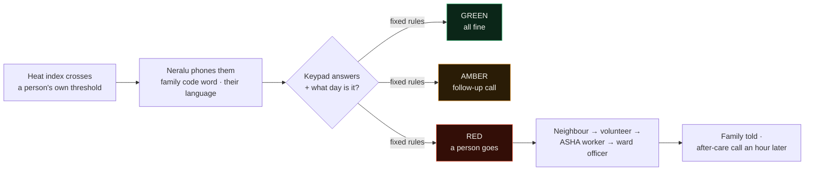
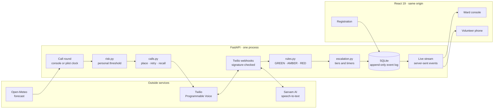
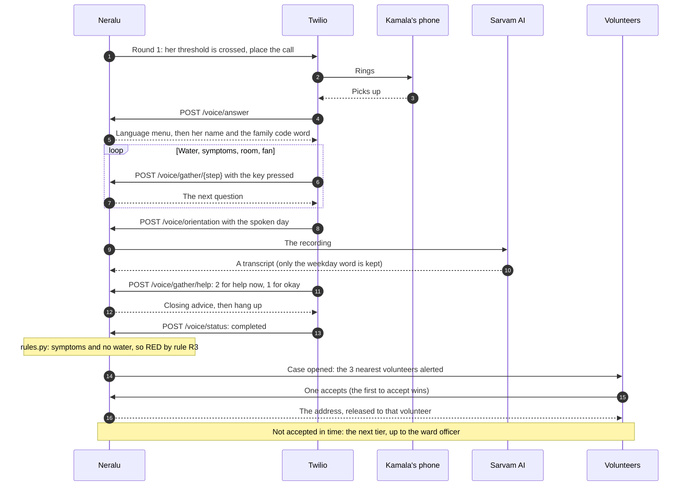

<div align="center">


# Neralu &nbsp;·&nbsp; ನೆರಳು

**Heat warnings tell a city what's coming. Neralu checks who's safe.**

A heatwave welfare-check system for older people who live alone: it phones them when the heat crosses
*their own* threshold, asks a few keypad questions, and sends a person to the door when an answer is worrying.

[](#sdgs)
[](#sdgs)
[](#sdgs)
[](#sdgs)


[](#tests)

<br />


[The problem](#the-problem) · [How it works](#how-it-works) · [Screens](#screens) · [Quick start](#quick-start) ·
[Architecture](#architecture) · [Backend](#backend) · [Frontend](#frontend) · [Safety and privacy](#safety-and-privacy-by-design) ·
[Real and simulated](#what-is-real-and-what-is-simulated) · [Tests](#tests) · [Docs](#documentation) · [Team](#team) · [Credits](#built-honestly-credits-and-pre-existing-work)

</div>

---

## The problem

In a heatwave the people most likely to be hurt are **older people who live alone**: often on a basic keypad
phone, often on heat-sensitive medicines, often under sheet roofs. India broadcasts heat alerts, but a
broadcast only *tells*. **Nobody checks** whether a particular person is all right, and heat varies sharply
within a single ward, so "it's fine today" for the city can be wrong for one house.

> India recorded **over 40,000 suspected heatstroke cases** between March and June 2024 (health ministry
> figures). Official counts miss many heat deaths outside hospitals.

## How it works



| | |
|---|---|
| **1 · Personal risk** | Each person's own heat threshold, from age, living alone, roof, fan and heat-sensitive medicines: never one city-wide number. |
| **2 · A call, not an app** | Any phone, in Kannada, Hindi or English, opening with a code word the family chose so it is never mistaken for a scam. People with memory difficulty are checked **through their caregiver** (rules C0–C6). |
| **3 · The day check** | "What day is it today?" Heat confusion can make someone say "I'm fine" when they are not. |
| **4 · Rules, not AI** | Fixed, published rules decide GREEN, AMBER or RED. Anything unclear is followed up, never assumed fine. |
| **5 · A person goes** | Neighbour, then the nearest volunteer, then an ASHA worker, then the ward officer, each with a timer. Neralu **never calls 108** itself; a human decides that. |
| **6 · Nobody is left** | After a visit Neralu calls again an hour later (E7). Families get a private, read-only status link. Every step is on the record. |

## Screens

<table>
  <tr>
    <td width="33%"><br /><sub><b>Story, the descent.</b> Scrolling flies past the sun to Earth and down through India.</sub></td>
    <td width="33%"><br /><sub><b>Ward 47 at 38 °C.</b> Each household lights up when the heat crosses its own threshold.</sub></td>
    <td width="33%"><br /><sub><b>The call, played by scroll.</b> Keypad answers, then RED by Rule R3, and a person is asked to go.</sub></td>
  </tr>
  <tr>
    <td width="33%"><br /><sub><b>Ward console.</b> Who is fine, who needs a follow-up, who is waiting for a person.</sub></td>
    <td width="33%"><br /><sub><b>Registration.</b> Five steps a family completes on any phone, with consent.</sub></td>
    <td width="33%"><br /><sub><b>The story page.</b> A real-time sun and Earth in three.js, holding 120 fps on an M4.</sub></td>
  </tr>
</table>

### Pages

| Page | Who it is for |
|---|---|
| `/` | The story: the problem, the call, the rules, who goes |
| `/ward` | The ward officer's live console (passcode sign-in: `OFFICER_PASSCODE` in `backend/.env`) |
| `/register` | A family registering an older relative |
| `/volunteer#<private token>` | A volunteer's phone: accept a case, record the visit (console > Demo controls > Priya's volunteer phone) |
| `/phone` | The browser phone, when a real call cannot be made |
| `/family#…` | A family's private, read-only status page |
| `/ward/record/:id` | A printable case record |
| `/responsible` | Data, consent and known risks |

## Quick start

```bash
# macOS / Linux: one command builds the site and serves everything on :8000
scripts/demo.sh

# Windows, on stage: starts everything and prints a go / no-go check
powershell -ExecutionPolicy Bypass -File scripts\stage.ps1
```

For development, run the two halves separately (Python 3.11+, Node 20+):

```bash
# Backend on :8000
cd backend
python -m venv .venv && source .venv/bin/activate      # Windows: .venv\Scripts\activate
pip install -e ".[dev]"
cp .env.example .env                                    # Twilio and Sarvam keys go here for real calls
python -m uvicorn app.main:app --port 8000

# Frontend on :5180, in a second terminal (proxies /api and /audio to :8000)
cd frontend
npm install
npm run dev -- --port 5180
```

Real phone calls, environment switches and every console feature: **[docs/RUNNING.md](docs/RUNNING.md)**.
A new laptop starts with **[SETUP.md](SETUP.md)**.

## SDGs

| Goal | Target | How Neralu serves it |
|---|---|---|
| **SDG 11** Sustainable cities | **11.5** fewer disaster deaths among the vulnerable | Scarce responders go only where a check says they are needed |
| **SDG 3** Good health | **3.d** early warning for health risks | A personal heat threshold turns a forecast into a call |
| **SDG 13** Climate action | **13.1** resilience to climate hazards | A ward-level routine for every heatwave |

## What is real and what is simulated

| Real | Simulated, and labelled so |
|---|---|
| The phone call (Twilio) to the demo phone, its keypad answers, the speech-to-text of a spoken day | Ward 47 and its ~400 residents (fictional names and places; no real people's data) |
| The rules, the escalation, the timers, the volunteer accepting on a real phone | Their call outcomes, the weather presets (a live Bengaluru forecast is optional), the ×60 demo clock |
| The live console, registration, the audit trail | Family notifications (real SMS is optional, off by default) |

## Architecture

One FastAPI process does everything: it decides who needs a call, rings them through Twilio, scores the
answers with fixed rules, runs the escalation timers, streams every step to the console, and serves the
built website on the same port. No queue, no separate worker, no hosted database: a one-second scheduler
loop and SQLite are enough for a ward, and keep the stage demo to one command.



```
backend/
  app/              FastAPI app: risk, rules, calls, escalation, privacy, pilot mode
    routes/         HTTP routes: /voice for Twilio, /api for the site and the console
  seed/             the fictional Ward 47: 400 residents, volunteers and ASHA workers
  static/audio/     recorded call prompts, one folder per language
  scripts/          prompt generation (Sarvam Bulbul), demo-day preflight check
  tests/            pytest suite
frontend/
  src/pages/        story, ward console, registration, volunteer, phone, family, case record, responsible
  src/components/   console panels; story/ holds the three.js hero and the call scene
  public/earth/     NASA and Sentinel-2 imagery for the story page
scripts/            one-command demo (demo.sh, demo.ps1) and stage scripts (stage.ps1)
docs/               plan, pitch, Round 2 brief, running guide, screenshots
```

## Backend

### Stack

| Layer | Technology | How Neralu uses it |
|---|---|---|
| Language | Python 3.11 | Typed throughout; `backend/requirements.txt` pins every version |
| Web framework | FastAPI 0.143 on Uvicorn | The API, Twilio's webhooks and the built site on one port; OpenAPI reference at `/docs` |
| Data | SQLModel 0.0.48 (SQLAlchemy 2.1, Pydantic 2) on SQLite in WAL mode | One file. Every row carries a `run_id`, so a reset or a new pilot day never mixes data; new columns are added in place, so a pilot day keeps its records |
| Settings | pydantic-settings | Every switch lives in `backend/.env` ([example](backend/.env.example)) |
| Phone calls | Twilio Programmable Voice, Python SDK 9 | Outbound calls; TwiML `<Gather>` for keypad answers, `<Record>` for the spoken day, `<Play>` for the recorded prompts |
| Speech | Sarvam AI: *Saaras v4* speech-to-text, *Bulbul v4* text-to-speech | Saaras turns the spoken day into a word during the call; Bulbul generated the prompts ahead of time (`scripts/make_audio.py`) |
| Weather | Open-Meteo, through HTTPX | Today's and tomorrow's Bengaluru forecast, free and keyless, cached for 30 minutes |
| Live updates | Server-sent events (sse-starlette) | Each event reaches the console after its database commit, with a 10 s heartbeat |
| Background work | One asyncio task | A one-second tick: place due calls, enforce ring timeouts, run escalation timers, delete old recordings |
| Tests | pytest 9, pytest-asyncio | 287 tests in about 15 seconds |

### A check-in call, end to end



### Inside `backend/app`

| Module | What it does |
|---|---|
| `risk.py` | Heat index (US National Weather Service Rothfusz regression); a vulnerability score from age, living alone, roof, fan, medicines, memory and hearing; each person's own threshold |
| `rules.py` | **The only place an outcome is decided.** Rules R0–R9 for a direct call, C0–C6 through a caregiver, S1 for "needs support". First match wins; "I'm okay" never overrides another sign |
| `calls.py` | Call rounds, placing due calls, retries when nobody answers, recalls after AMBER, the after-care call an hour after a visit |
| `escalation.py` | Cases and the human tiers (neighbour, nearest volunteers, ASHA worker, ward officer), with acceptance (E5) and visit (E8) timers |
| `telephony.py`, `routes/voice.py` | The TwiML for each step of the call, Twilio's webhooks and their signature check |
| `transcribe.py`, `orientation.py` | Sarvam speech-to-text, then a fixed dictionary of weekday names in Kannada, Hindi and English |
| `events.py` | The append-only event log; an event is pushed to the live stream only after its transaction commits |
| `officer.py` | The console sign-in: an HMAC-signed HttpOnly cookie, and a lockout after repeated wrong passcodes |
| `family.py`, `privacy.py`, `erase.py` | The family's private status link, the erasure code, the recording retention limit, the right to erasure |
| `pilot.py`, `runs.py`, `weather.py`, `clock.py` | Pilot mode (a real day, run by itself on today's forecast) and the ×60 demo clock |
| `whatif.py`, `impact.py`, `rounds.py` | The what-if planner, the impact panel (a broadcast alert against Neralu), past rounds |
| `sim_caller.py`, `browser_phone.py`, `missed_call.py` | The simulated residents' answers, the browser-phone fallback, missed-call check-ins |
| `status.py` | The console's go / no-go checks: public URL, scheduler, Twilio account, last real call |
| `views.py` | Read models for the API; list views never include a phone number or an address |

### The API

Fifty routes. While the server runs, the interactive OpenAPI reference is at
[localhost:8000/docs](http://localhost:8000/docs).

| Routes | Who can call them |
|---|---|
| `/voice/*`: answer, language, gather, orientation, status, inbound | Twilio only: every request's signature is checked |
| `GET /api/households`, `/api/clock`, `/api/rules` | Anyone. The story and volunteer pages read these; a family-registered household carries no name, age or health details and is placed only to about 1 km |
| `POST /api/elders` | Anyone: a family registering a relative, with consent |
| `/api/family/*` | Whoever holds a family's private link, which is stored only as a hash |
| `DELETE /api/elders/{id}` | Whoever holds the family's erasure code |
| `/api/cases/{id}/accept`, `/decline`, `/resolve`, `/api/volunteer/*` | A volunteer, by their private token |
| `/api/phone/*` | The browser phone, the demo fallback for a real call |
| `GET /api/stream` | Anyone, but only the signed-in console receives event details; others receive the kind of event alone |
| `/api/elders`, `/api/cases`, `/api/summary`, `/api/events`, `/api/impact`, `/api/rounds`, `/api/status`, `/api/responders`, `/api/whatif`, `/api/recordings/*`, `/api/sim/*` | The ward officer, signed in through `/api/officer/login` |

### Configuration

Everything is set in `backend/.env`; [`backend/.env.example`](backend/.env.example) lists every option, and
[docs/RUNNING.md](docs/RUNNING.md) explains them. The ones that matter most:

| Setting | Default | What it does |
|---|---|---|
| `TELEPHONY_MODE` | `twilio` | `browser` rings the `/phone` page instead of a SIM: same prompts, same rules |
| `TWILIO_ACCOUNT_SID`, `TWILIO_AUTH_TOKEN`, `TWILIO_FROM_NUMBER` | none | Real calls |
| `PUBLIC_BASE_URL` | `http://localhost:8000` | The public address Twilio calls back (ngrok on stage) |
| `SARVAM_API_KEY` | none | Speech-to-text for the spoken day. Without it the day counts as unanswered, which is followed up (R7), never taken as fine |
| `ORIENTATION_MODE` | `voice` | `keypad`: press 1–7 for the day (Twilio trial accounts cannot record) |
| `RUN_MODE` | `demo` | `pilot`: real time, today's forecast, rounds at `PILOT_ROUND_TIMES`, none after `PILOT_CALLS_UNTIL` |
| `DEMO_SPEED` | `60` | One real second is one scenario minute |
| `OFFICER_PASSCODE` | random each start | The ward console passcode, printed in the server window when not set |
| `FAMILY_SMS` | `simulated` | `twilio`: real SMS to families who registered someone |
| `RECORDING_RETENTION_DAYS` | `7` | Call recordings are deleted this long after the call |

## Frontend

| | |
|---|---|
| **App** | React 19, TypeScript 6, Vite 8, React Router 7, Tailwind CSS 4 with design tokens in `src/styles/tokens.css` |
| **Story page** | One three.js scene: a sun drawn by GPU shaders, Earth with a ray-marched Rayleigh and Mie atmosphere, a volumetric god-ray pass, NASA and Sentinel-2 imagery. GSAP ScrollTrigger plays it by scroll, and the resolution adapts to hold the frame rate (120 fps on an M4). With `prefers-reduced-motion` it is one still frame |
| **Ward console** | A Leaflet map and a 3D ward in three.js; live through `EventSource` on `/api/stream`, refetching anything missed after a reconnect |
| **Motion** | GSAP for scroll scenes, Motion (`motion/react`) for page transitions and reveals |
| **Checks** | `npm run lint` (oxlint); `npm run build` type-checks and writes `frontend/dist`, which FastAPI serves |

## Safety and privacy by design

Each of these is in the code, and most have their own tests.

- **Rules decide, not AI.** `rules.py` is a first-match-wins table with tests for every rule. The console
  and the story page read its wording from `GET /api/rules`. No language model runs anywhere.
- **Never assumed fine.** A call picked up with no answers is *not reached* (R0), an unclear day is AMBER (R7),
  and "I'm okay" never overrides another warning sign.
- **Never calls 108.** Only a person records "called 108" as the way a case ended.
- **Nobody is left without someone asked.** If a tier has no one on duty the case moves on at once, and every
  tier has a timer, ending with the ward officer.
- **Exactly one volunteer goes.** Accepting is a single SQL compare-and-set (`UPDATE … WHERE state = 'open'`), so
  two people tapping at the same moment are never both sent.
- **Webhooks are verified.** Twilio's signature is checked on every request, and anything carrying an earlier
  run's `run_id` (a late webhook, an old timer) is ignored.
- **Safety nets for a weak network.** Neralu enforces the ring timeout itself and closes calls whose final
  Twilio callback never arrived.
- **Least data, kept for the least time.** List views never show a phone number. An address is shown only after
  someone accepts. Only the weekday word is kept from a spoken answer. Recordings are deleted after 7 days.
- **Secrets stored as hashes.** The family's status link and erasure code are random, shown once and stored
  only as hashes; with the code, a family can erase everything Neralu holds about their relative.
- **The console is signed in.** An HttpOnly, SameSite=Strict cookie for 12 hours, and a lockout after 5 wrong
  passcodes in 15 minutes. Volunteer links are random and kept after the `#`, so no server log ever holds one.

The `/responsible` page sets this out for families, with notes on India's DPDP Act 2023 (our reading, not a
legal review).

## Tests

```bash
cd backend && source .venv/bin/activate     # Windows: .venv\Scripts\activate
pytest                                      # 287 tests, about 15 seconds

cd frontend
npm run lint && npm run build               # oxlint, then a type-check and a production build
```

The backend suite has 28 files. It covers:
- every rule in the table, the heat index and the thresholds;
- whole calls driven through the Twilio webhooks, by keypad and by voice;
- the escalation tiers and timers, and reassignment when a volunteer declines or goes off duty;
- the officer sign-in, erasure, recording retention and family links;
- pilot mode across restarts, the what-if planner, and the website served by FastAPI.

## Known limits

We would rather say these than have a judge find them.

- A phone check cannot see the person. The thresholds are starting values, to be calibrated in a pilot.
- People with no phone, and no one to register them, are not reached. ASHA and resident-association lists are the way to find them.
- A code word can leak. Families should pick one only the household knows.
- There is no check-in yet for the volunteer's own safety during a visit.
- The Kannada wording of the prompts still needs review by a native speaker.
- One process and SQLite suit a ward pilot. Many wards would need a server database; SQLModel can take one through
  `DATABASE_URL`, but only SQLite is tested.

## Documentation

| Document | What is in it |
|---|---|
| [docs/RUNNING.md](docs/RUNNING.md) | Running, real calls, switches, every console feature |
| [SETUP.md](SETUP.md) | Installing on a new laptop, settings, common fixes |
| [docs/NERALU_PLAN.md](docs/NERALU_PLAN.md) | Full spec, design rules and decisions |
| [docs/HACKATHON_PLAN.md](docs/HACKATHON_PLAN.md) · [docs/ROUND2_BRIEF.md](docs/ROUND2_BRIEF.md) | Finale plan and the Round 2 brief |
| [docs/PITCH.md](docs/PITCH.md) | The pitch and demo script, with sources |
| [docs/IDEATHON_IMPROVEMENTS.md](docs/IDEATHON_IMPROVEMENTS.md) | Improvements noted after the ideathon |
| [CLAUDE.md](CLAUDE.md) | Rules for working in this repo |

## Team

| Name | GitHub |
|---|---|
| Priyanshu Kumar Senapati | [@Priyanshu-senapati](https://github.com/Priyanshu-senapati) |
| Gourab Dash | [@gd23456](https://github.com/gd23456) |
| Mohsin | [@mohsin200711](https://github.com/mohsin200711) |
| Vinochan R | [@Vkun2508](https://github.com/Vkun2508) |

## Built honestly: credits and pre-existing work

**Pre-existing work.** Neralu was designed for the Hack4SDG ideathon (prelims, 9 Oct 2026) and built
before the finale: the git history starts on 8 Oct 2026 and is public. Everything up to the git tag
**`pre-finale`** existed before the finale began (12:00, 24 Oct 2026); everything after it was built at
the finale. `git log pre-finale..main` lists the finale work.

**AI tools.**
- **Claude Code** (Anthropic): wrote most of the code under the team's direction and review, and helped
  plan, test and debug.
- **ChatGPT** (OpenAI): brainstorming and reviewing the feature plan.
- **Sarvam AI**: *Bulbul* text-to-speech generated the call prompts (Kannada, Hindi, Indian English);
  *Saaras* speech-to-text transcribes a spoken day during calls. The Kannada wording still needs
  review by a native speaker.
- **Amazon Polly** (through Twilio `<Say>`) and the browser's built-in voice speak a prompt only when
  its recorded clip does not exist yet (the caregiver prompts today). Same fixed text; nothing is generated.
- No language model runs anywhere in Neralu. AI never decides an outcome in Neralu: `backend/app/rules.py` does, with tests.

**APIs and services.** Twilio (calls, optional SMS) · Sarvam AI (speech) · Open-Meteo (optional live
forecast, free, no key) · ngrok (public tunnel for the demo) · Google Maps (volunteer "Open in Maps" link).

**Data, maps and methods.** Basemap tiles © Esri, HERE, Garmin, © OpenStreetMap contributors (Esri
World Light Gray Base) · heat index by the US National Weather Service Rothfusz regression · all
residents, addresses and phone numbers in the demo ward are fictional.

**Open-source libraries.** Backend: FastAPI, Uvicorn, SQLModel / SQLAlchemy, Pydantic, Twilio Python SDK,
HTTPX, sse-starlette, python-multipart, pytest. Frontend: React, React Router, Vite, TypeScript,
Tailwind CSS, Leaflet and react-leaflet, three.js, d3, GSAP, Motion, lucide-react, clsx, tailwind-merge.
Exact versions: `backend/requirements.txt`, `frontend/package-lock.json`.

**Borrowed UI components** (adapted, credited in each file): from [21st.dev](https://21st.dev) the
FlowButton, the shader animation behind the story page's hero and the "wireframe dotted globe" (rebuilt
in three.js); a Spline demo kept for reference only, not used.

**Story page** (written for Neralu): the hero is one three.js scene (sun, Earth, Ward 47). Earth maps:
NASA Blue Marble Next Generation, May 2004, and Black Marble 2016 city lights, and Blue Marble clouds
(NASA Earth Observatory, public domain). Bengaluru and Ward 47 from orbit: *Sentinel-2 cloudless 2016*
by EOX IT Services GmbH (contains modified Copernicus Sentinel data 2016), CC BY 4.0, credited in the
page footer. 3D simplex noise in the shaders: webgl-noise by Ian McEwan and Stefan Gustavson (MIT); the
heat haze uses Gustavson's public-domain 2D simplex noise. Ideas only, no code copied: helical wakes and
orbit motion from Yura Dubinin's *Orbital Hero Section* (MIT) and the scroll-played call from Hossain
Jahed's *Cinematic Landing Hero*, both on 21st.dev. Fonts on that page: Geist, Geist Mono, Instrument Serif.

**Fonts** (Google Fonts): Public Sans, IBM Plex Mono, Newsreader, Noto Sans Kannada.

---

<div align="center">
<sub><span lang="kn">ನೆರಳು</span> (neralu) means <i>shade</i> in Kannada. Welfare checks for the people a heatwave hurts first.</sub>
</div>
