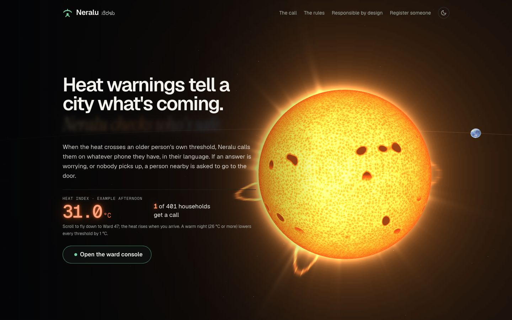
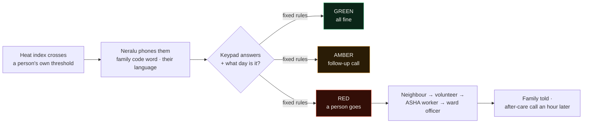
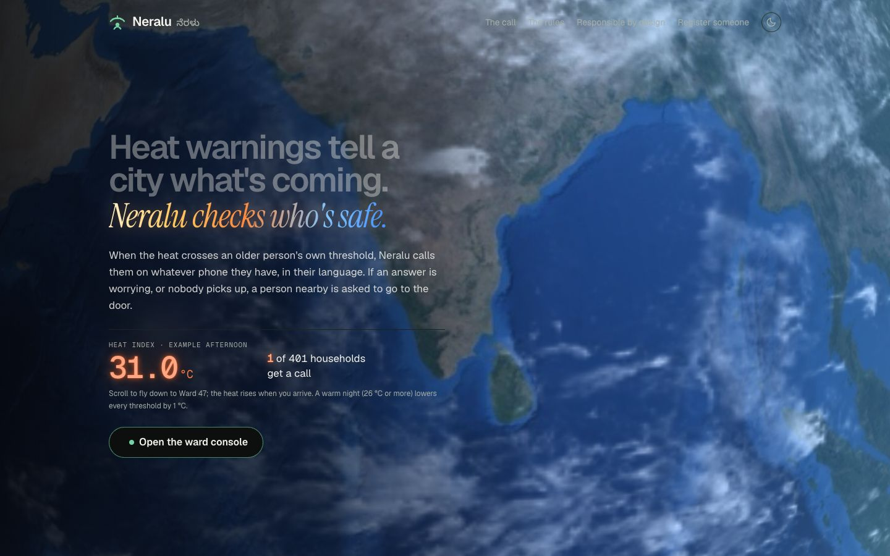
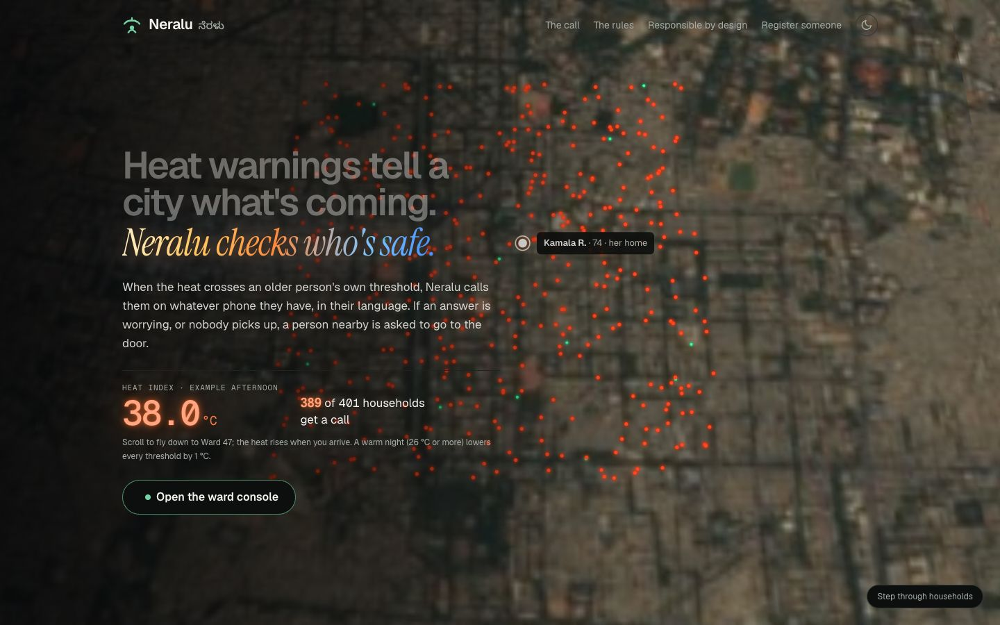
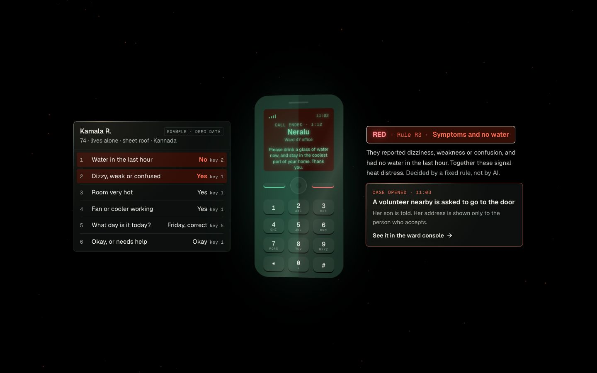
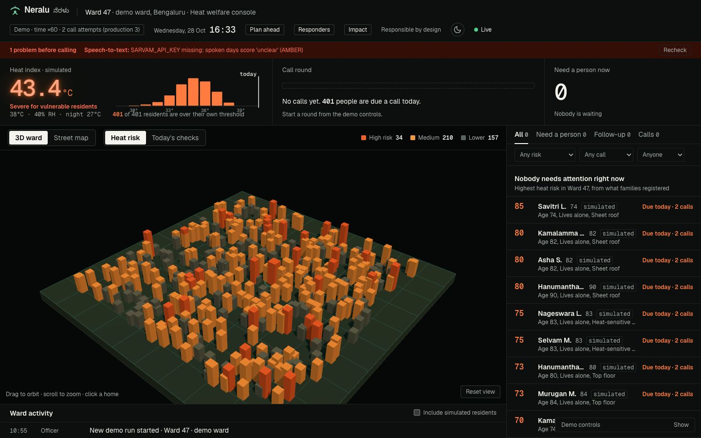
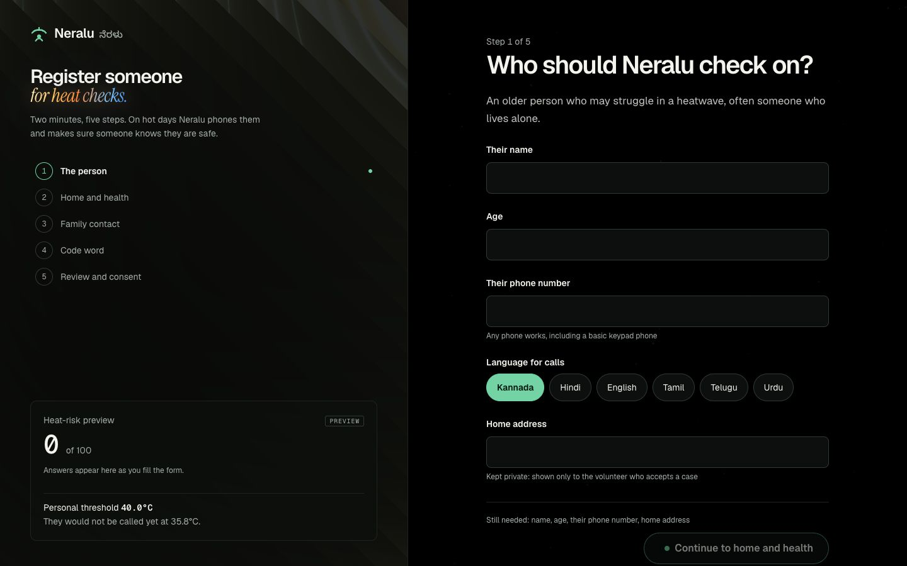
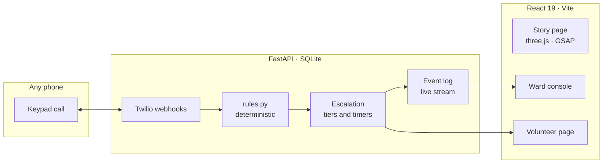

<div align="center">


# Neralu &nbsp;·&nbsp; ನೆರಳು

**Heat warnings tell a city what's coming. Neralu checks who's safe.**

A heatwave welfare-check system for older people who live alone: it phones them when the heat crosses
*their own* threshold, asks a few keypad questions, and sends a person to the door when an answer is worrying.

[](#sdgs)
[](#sdgs)
[](#sdgs)
[](#sdgs)


<br />



[The problem](#the-problem) · [How it works](#how-it-works) · [Screens](#screens) · [Quick start](#quick-start) ·
[Real and simulated](#what-is-real-and-what-is-simulated) · [Docs](#documentation) · [Team](#team) · [Credits](#built-honestly-credits-and-pre-existing-work)

</div>

---

## The problem

In a heatwave the people most likely to be hurt are **older people who live alone**: often on a basic keypad
phone, often on heat-sensitive medicines, often under sheet roofs. India broadcasts heat alerts, but a
broadcast only *tells*. **Nobody checks** whether a particular person is all right, and heat varies sharply
within a single ward, so "it's fine today" for the city can be wrong for one house.

> India recorded **over 40,000 suspected heatstroke cases** between March and June 2024 (health ministry
> figures). Official counts miss many heat deaths outside hospitals.

## How it works



| | |
|---|---|
| **1 · Personal risk** | Each person's own heat threshold, from age, living alone, roof, fan and heat-sensitive medicines: never one city-wide number. |
| **2 · A call, not an app** | Any phone, in Kannada, Hindi or English, opening with a code word the family chose so it is never mistaken for a scam. People with memory difficulty are checked **through their caregiver** (rules C0–C6). |
| **3 · The day check** | "What day is it today?" Heat confusion can make someone say "I'm fine" when they are not. |
| **4 · Rules, not AI** | Fixed, published rules decide GREEN, AMBER or RED. Anything unclear is followed up, never assumed fine. |
| **5 · A person goes** | Neighbour, then the nearest volunteer, then an ASHA worker, then the ward officer, each with a timer. Neralu **never calls 108** itself; a human decides that. |
| **6 · Nobody is left** | After a visit Neralu calls again an hour later (E7). Families get a private, read-only status link. Every step is on the record. |

## Screens

<table>
  <tr>
    <td width="33%"><br /><sub><b>Story, the descent.</b> Scrolling flies past the sun to Earth and down through India.</sub></td>
    <td width="33%"><br /><sub><b>Ward 47 at 38 °C.</b> Each household lights up when the heat crosses its own threshold.</sub></td>
    <td width="33%"><br /><sub><b>The call, played by scroll.</b> Keypad answers, then RED by Rule R3, and a person is asked to go.</sub></td>
  </tr>
  <tr>
    <td width="33%"><br /><sub><b>Ward console.</b> Who is fine, who needs a follow-up, who is waiting for a person.</sub></td>
    <td width="33%"><br /><sub><b>Registration.</b> Five steps a family completes on any phone, with consent.</sub></td>
    <td width="33%"><br /><sub><b>The story page.</b> A real-time sun and Earth in three.js, holding 120 fps on an M4.</sub></td>
  </tr>
</table>

### Pages

| Page | Who it is for |
|---|---|
| `/` | The story: the problem, the call, the rules, who goes |
| `/ward` | The ward officer's live console |
| `/register` | A family registering an older relative |
| `/volunteer?token=priya-demo` | A volunteer's phone: accept a case, record the visit |
| `/phone` | The browser phone, when a real call cannot be made |
| `/family#…` | A family's private, read-only status page |
| `/ward/record/:id` | A printable case record |
| `/responsible` | Data, consent and known risks |

## Quick start

```bash
# macOS / Linux: one command builds the site and serves everything on :8000
scripts/demo.sh

# Windows, on stage: starts everything and prints a go / no-go check
powershell -ExecutionPolicy Bypass -File scripts\stage.ps1
```

Development, real phone calls, environment switches and every console feature: **[docs/RUNNING.md](docs/RUNNING.md)**.
A new laptop starts with **[SETUP.md](SETUP.md)**.

## SDGs

| Goal | Target | How Neralu serves it |
|---|---|---|
| **SDG 11** Sustainable cities | **11.5** fewer disaster deaths among the vulnerable | Scarce responders go only where a check says they are needed |
| **SDG 3** Good health | **3.d** early warning for health risks | A personal heat threshold turns a forecast into a call |
| **SDG 13** Climate action | **13.1** resilience to climate hazards | A ward-level routine for every heatwave |

## What is real and what is simulated

| Real | Simulated, and labelled so |
|---|---|
| The phone call (Twilio) to the demo phone, its keypad answers, the speech-to-text of a spoken day | Ward 47 and its ~400 residents (fictional names and places; no real people's data) |
| The rules, the escalation, the timers, the volunteer accepting on a real phone | Their call outcomes, the weather presets (a live Bengaluru forecast is optional), the ×60 demo clock |
| The live console, registration, the audit trail | Family notifications (real SMS is optional, off by default) |

## Architecture



```
backend/    FastAPI app: risk, rules, calls, escalation, pilot mode (pytest suite in backend/tests)
frontend/   React app: story page, ward console, volunteer, registration, family view
scripts/    one-command demo and stage scripts, voice prompt generation
docs/       plan, pitch, Round 2 brief, running guide, screenshots
```

**Tech stack.** Python 3.11, FastAPI, SQLModel and SQLite, Twilio Programmable Voice, Sarvam AI speech ·
React 19, TypeScript, Vite, Tailwind CSS, three.js, GSAP, Motion, Leaflet, d3.

## Documentation

| Document | What is in it |
|---|---|
| [docs/RUNNING.md](docs/RUNNING.md) | Running, real calls, switches, every console feature |
| [SETUP.md](SETUP.md) | Installing on a new laptop, settings, common fixes |
| [docs/NERALU_PLAN.md](docs/NERALU_PLAN.md) | Full spec, design rules and decisions |
| [docs/HACKATHON_PLAN.md](docs/HACKATHON_PLAN.md) · [docs/ROUND2_BRIEF.md](docs/ROUND2_BRIEF.md) | Finale plan and the Round 2 brief |
| [docs/PITCH.md](docs/PITCH.md) | The pitch and demo script, with sources |
| [docs/IDEATHON_IMPROVEMENTS.md](docs/IDEATHON_IMPROVEMENTS.md) | Improvements noted after the ideathon |
| [CLAUDE.md](CLAUDE.md) | Rules for working in this repo |

## Team

| Name | GitHub |
|---|---|
| Priyanshu Kumar Senapati | [@Priyanshu-senapati](https://github.com/Priyanshu-senapati) |
| Gourab Dash | [@gd23456](https://github.com/gd23456) |
| Mohsin | [@mohsin200711](https://github.com/mohsin200711) |
| | [@Vkun2508](https://github.com/Vkun2508) |

## Built honestly: credits and pre-existing work

**Pre-existing work.** Neralu was designed for the Hack4SDG ideathon (prelims, 9 Oct 2026) and built
before the finale: the git history starts on 8 Oct 2026 and is public. Everything up to the git tag
**`pre-finale`** existed before the finale began (12:00, 24 Oct 2026); everything after it was built at
the finale. `git log pre-finale..main` lists the finale work.

**AI tools.**
- **Claude Code** (Anthropic): wrote most of the code under the team's direction and review, and helped
  plan, test and debug.
- **ChatGPT** (OpenAI): brainstorming and reviewing the feature plan.
- **Sarvam AI**: *Bulbul* text-to-speech generated the call prompts (Kannada, Hindi, Indian English);
  *Saaras* speech-to-text transcribes a spoken day during calls. The Kannada wording still needs
  review by a native speaker.
- **Amazon Polly** (through Twilio `<Say>`) and the browser's built-in voice speak a prompt only when
  its recorded clip does not exist yet (the caregiver prompts today). Same fixed text; nothing is generated.
- No language model runs anywhere in Neralu. AI never decides an outcome in Neralu: `backend/app/rules.py` does, with tests.

**APIs and services.** Twilio (calls, optional SMS) · Sarvam AI (speech) · Open-Meteo (optional live
forecast, free, no key) · ngrok (public tunnel for the demo) · Google Maps (volunteer "Open in Maps" link).

**Data, maps and methods.** Basemap tiles © Esri, HERE, Garmin, © OpenStreetMap contributors (Esri
World Light Gray Base) · heat index by the US National Weather Service Rothfusz regression · all
residents, addresses and phone numbers in the demo ward are fictional.

**Open-source libraries.** Backend: FastAPI, Uvicorn, SQLModel / SQLAlchemy, Pydantic, Twilio Python SDK,
HTTPX, sse-starlette, python-multipart, pytest. Frontend: React, React Router, Vite, TypeScript,
Tailwind CSS, Leaflet and react-leaflet, three.js, d3, GSAP, Motion, lucide-react, clsx, tailwind-merge.
Exact versions: `backend/requirements.txt`, `frontend/package-lock.json`.

**Borrowed UI components** (adapted, credited in each file): from [21st.dev](https://21st.dev) the
FlowButton, the shader animation behind the story page's hero and the "wireframe dotted globe" (rebuilt
in three.js); a Spline demo kept for reference only, not used.

**Story page** (written for Neralu): the hero is one three.js scene (sun, Earth, Ward 47). Earth maps:
NASA Blue Marble Next Generation, May 2004, and Black Marble 2016 city lights, and Blue Marble clouds
(NASA Earth Observatory, public domain). Bengaluru and Ward 47 from orbit: *Sentinel-2 cloudless 2016*
by EOX IT Services GmbH (contains modified Copernicus Sentinel data 2016), CC BY 4.0, credited in the
page footer. 3D simplex noise in the shaders: webgl-noise by Ian McEwan and Stefan Gustavson (MIT); the
heat haze uses Gustavson's public-domain 2D simplex noise. Ideas only, no code copied: helical wakes and
orbit motion from Yura Dubinin's *Orbital Hero Section* (MIT) and the scroll-played call from Hossain
Jahed's *Cinematic Landing Hero*, both on 21st.dev. Fonts on that page: Geist, Geist Mono, Instrument Serif.

**Fonts** (Google Fonts): Public Sans, IBM Plex Mono, Newsreader, Noto Sans Kannada.

---

---

<div align="center">
<sub><span lang="kn">ನೆರಳು</span> (neralu) means <i>shade</i> in Kannada. Welfare checks for the people a heatwave hurts first.</sub>
</div>
